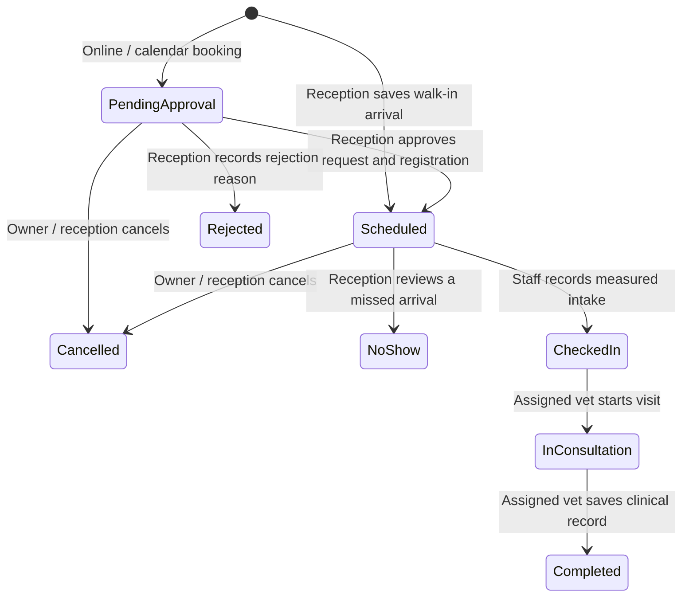

# Clinic process

All roles follow the saved owner → patient → visit → clinical record → checkout
connection. The visit purpose determines the clinical form and services recorded.
Booking does not certify treatment or create a paid bill.

## Online and walk-in starting points

| Stage | Online owner | Reception / assistant |
|---|---|---|
| Owner identity | Verify the online account. If clinic records already exist, request reception linking. | Review both identities and confirm the explicit clinic owner before linking records. |
| Patient | Submit each new pet's registration details. | Review patient registration, together with its pending booking when present. |
| Visit request | Choose the pet, purpose, veterinarian, date and available time. The request is **Pending Approval**. | Review the full request. Approval verifies a pending pet and saves the visit as **Scheduled**. |
| Walk-in | Give reception the owner's and pet's details. | Select the existing owner/patient or register them. Approve pending registration first. Save a **Scheduled** walk-in arrival without inventing intake. |
| Measured intake | Arrive at the clinic. | Save actual measurements and triage. The visit becomes **Checked-in** for its assigned vet. |

The labels above represent saved statuses **Pending Approval**, **Scheduled**,
**Checked-in**, **In consultation**, **Completed**, **Rejected**, **Cancelled** and
**No-show**. The old **Confirmed** status is retired. Past visits are not silently
marked no-show on page load: reception reviews the saved appointment and time.
An initial arrival uses the clinic date; reschedule a different-day appointment
before initial check-in. Earlier unfinished clinical visits remain visible.

## Clinical care and checkout

- The assigned veterinarian records care for the visit purpose. Vaccination and
  deworming use their own records; consultation and surgical assessment use SOAP;
  grooming uses a grooming record. Consultation history prompts match the saved
  reason (wellness, skin/ear, injury, digestive, appetite, dental, surgery, urgent
  care or recheck). Confirmed preventive/grooming care generates its documentation;
  deferrals require a reason and next steps. The veterinarian records actual doses and
  approves the next due date. Imported history and planned doses are separate.
- A vet can transfer an active visit to another vet with saved handoff
  instructions. The receiving vet gets the same visit and permitted history in
  the waiting queue. Draft instructions require confirmation before discarding;
  failed submissions keep entries available for correction and retry.
- Saving the clinical record completes the visit and creates its reception
  checkout task. The inbox recovers earlier unpaid visits and waits while another
  dialog is open. It does not interrupt a rejection, profile or clinical form.
- Reception reviews the saved services/products, records payment and issues the
  saved receipt. Booking amounts are not invoice totals. Draft totals come from
  saved itemized charges; missing totals remain unrecorded.
- If admission is required, the veterinarian orders admission and care. The
  assistant records consent, observations and actual medicine events. The vet
  finalizes visit notes and approves discharge; reception then records payment
  and separately confirms the pet's actual release. A completed visit remains
  held from checkout while its admission is **Admitted**.
- Owners see their own saved visits, charges, receipts, shared admission updates
  and follow-up instructions. Standard vaccination cards record actual doses and
  do not depend on payment or a clinic-document setup screen.
- Explicit linked follow-up requests retain their patient and clinical record.
  Rebooking cancelled/rejected/no-show follow-ups does not duplicate completed
  care. Vaccine reminders use current certified recall records, with delivery
  results recorded separately from a staff phone-call note.
- Admin manages staff access, catalog/clinical choices, reports and audit history.
  Reception owns approvals, arrival coordination and payment; the veterinarian
  owns diagnosis, clinical orders and discharge approval.

For deployment and verification, see [workflow-rollout.md](workflow-rollout.md).
